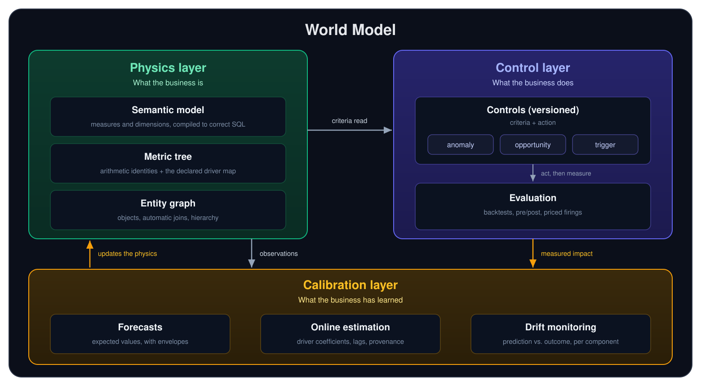

The **World Model**, **Matrix** in Oxygen Nexus, is Oxygen's formula-first model of your business. It
defines every metric that matters as an equation over its drivers, so that
agents and applications can explain why an outcome moved and what to do about
it.

Everything in the World Model fits into three layers:

- The **physics layer** models what the business *is*: its measures and the
  equations that define them, the qualitative map of what drives what, and
  the real objects that produce them.
- The **calibration layer** models what the business has *learned*: the
  estimated parameters behind the physics, such as forecasts, lags, and driver
  magnitudes, revised continuously as new evidence arrives.
- The **control layer** models what the business *does*: the versioned
  decision rules that read the physics and move its levers, and the
  evaluation that measures what each change actually did.

<Frame caption="The physics layer declares how outcomes depend on their drivers, the control layer acts on the business, and the calibration layer learns from every observation and intervention and writes the result back into the physics.">
  
</Frame>

## A Digital Twin of the physics

Most digital twins model a business from the bottom up, cataloging its
machines, parts, and stores so that operators can monitor each one. Oxygen
builds the twin from the top down instead, starting at the outcome you are
accountable for and modeling downward toward the drivers you can actually
move. The result is a set of equations faithful enough to forecast with,
backtest against, and use to change what the business produces. Where a twin
of the parts tells you the state of everything, a twin of the physics tells
you what to do. For how this differs from an object-first platform such as
Palantir Foundry, see [Compared to Palantir](/guide/build/world-model/compared-to-palantir).

## The physics layer

- **[Semantic Model](/guide/build/semantic-model/simple-model): the
  vocabulary.** Measures and dimensions are defined once and compiled into
  correct SQL by [airlayer](https://github.com/oxy-hq/airlayer), with no LLM
  in the compilation path, so the same request always produces the same
  SQL.
- **[Metric Tree](/guide/build/world-model/metric-tree): the relationships.**
  Every top-line metric decomposes into the drivers that explain it, which
  powers root-cause analysis and scenario prediction.
- **[Entity Graph](/guide/build/semantic-model/entities#the-entity-graph): the
  objects.** Measures are tied to the stores, employees, customers, and orders
  that produce them, so any metric can be sliced, rolled up, and acted on.

## The calibration layer

The physics layer *declares* relationships: that sales depend on ad spend,
price, and availability, or that a supplier's lead time is about a week.
Some of those relationships are accounting identities and are exact. Most
are empirical, and their parameters are uncertain. The
[**calibration layer**](/guide/build/world-model/calibration) owns those
parameters. It refits them incrementally as new data lands, compares every
prediction with what actually happened, and flags any component whose error
drifts. Because this happens in one shared layer rather than inside each
application, every forecast, scenario, and control reads the same estimates
and inherits the same drift monitoring.

Calibration is learning, not proof. An estimate fitted from history stays
labeled as observational, and only the measured effect of an intervention
can promote a driver magnitude to an authoritative one.

## The control layer

A [control](/guide/build/world-model/controls) codifies a standing practice,
such as "reorder before a SKU runs out," as **criteria** that state when to
act and an **action** that states what to do. Because both are written in
World Model terms, every control can be backtested against your own history.
The same primitive powers three engines:

- The **Control Engine** *runs* the business, executing the decisions the
  company operates by, such as replenishing, staffing, and pricing.
- The **[Opportunity Engine](/guide/build/world-model/opportunity-sizing)**
  *expands* it, finding where the business underperforms its own benchmark
  and sizing the gap in dollars.
- The **Anomaly Engine** *fixes* it, detecting when an outcome breaks from its
  forecast and tracing the break to its root cause.

[**Evaluation**](/guide/build/world-model/evaluation) then measures what each
change actually did.

## The feedback cycle

The three layers form one loop: the physics **observes and predicts**, the
control layer **decides and acts**, evaluation **measures** the result, and
calibration **updates** the physics that the next prediction runs on.
Keeping these responsibilities separate means a model assumption, a policy
threshold, and a retraining rule never have to be buried together inside a
single application's code, and each decision runs on physics that is a
little sharper than the last.

## Next steps

<CardGroup cols={2}>
  <Card title="Semantic Model" icon="cube" href="/guide/build/semantic-model/simple-model">
    Define measures, dimensions, and entities
  </Card>
  <Card title="Controls" icon="sliders" href="/guide/build/world-model/controls">
    Codify the practices the business runs on
  </Card>
  <Card title="Evaluation" icon="scale-balanced" href="/guide/build/world-model/evaluation">
    Version comparison and criteria-triggered measurement
  </Card>
  <Card title="Calibration" icon="code-compare" href="/guide/build/world-model/calibration">
    How the physics learns from every observation and intervention
  </Card>
  <Card title="Compared to Palantir" icon="code-branch" href="/guide/build/world-model/compared-to-palantir">
    Outcome-centric versus object-centric operational models
  </Card>
</CardGroup>
